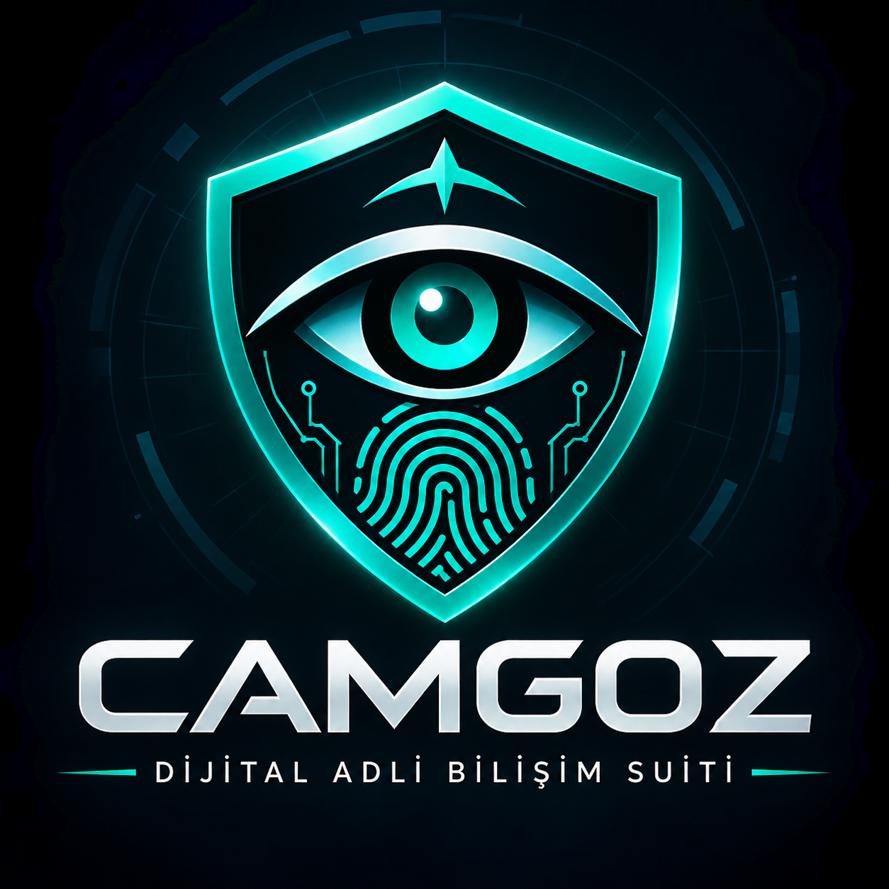

# CAMGOZ – Dijital Adli Bilişim Suite

<p align="center">
  
</p>

<p align="center">
  <strong>Dijital Adli Bilişim ve İnceleme Platformu</strong>
</p>

<p align="center">
  Python · PySide6 · SQLAlchemy · SQLite · Windows
</p>

---

## Hakkında

**CAMGOZ**, dijital kanıtların toplanması, incelenmesi, analiz edilmesi ve yönetilmesi amacıyla geliştirilmiş Windows tabanlı bir dijital adli bilişim uygulamasıdır.

Python ve PySide6 kullanılarak geliştirilen CAMGOZ; kanıt yönetimi, dosya adli analizi, Windows izleri, tarayıcı incelemesi, USB aktivite takibi, zaman çizelgesi analizi ve sezgisel tehdit tespiti özelliklerini tek bir masaüstü uygulamasında bir araya getirir.

Ayrıca kanıt bütünlüğünün doğrulanması ve denetim kayıtlarının takibi için çeşitli mekanizmalar içerir.

## Özellikler

### 1. Kanıt Yönetimi
- Dijital kanıt kaydetme ve yönetme.
- Dosya metadata bilgilerinin çıkarılması.
- SHA-256 hash hesaplama.
- Kanıt bütünlüğü doğrulama.
- Toplu bütünlük doğrulama.
- Kanıtları arşivleme ve geri yükleme.
- PDF adli inceleme raporu oluşturma.

### 2. Dosya Adli Analizi
- Dosya imza (File Signature) analizi.
- Dosya uzantısı ve gerçek dosya türü uyuşmazlığı tespiti.
- Gömülü dosya imzalarını tarama.
- HEX görüntüleyici.
- HEX desen arama.

### 3. Windows İz Analizi
- Windows Recent Files analizi.
- USB cihazlarının tespiti.
- USB bağlantı ve bağlantı kesilme takibi.
- USB dosya hareketlerinin izlenmesi.
- Dosya oluşturma, değiştirme, silme ve yeniden adlandırma olaylarının takibi.

### 4. Tarayıcı Adli İncelemesi
- Google Chrome profil tespiti.
- Microsoft Edge profil tespiti.
- Mozilla Firefox profil tespiti.
- Tarayıcı geçmişi analizi.
- Arama kayıtlarının incelenmesi.
- İndirme geçmişinin analizi.

### 5. Zaman Çizelgesi Analizi
- Birleşik adli olay zaman çizelgesi.
- Kanıt ve denetim kayıtlarının birleştirilmesi.
- USB aktivitelerinin ilişkilendirilmesi.
- Tarayıcı ve Windows izlerinin karşılaştırılması.
- Günlük ve saatlik aktivite grafikleri.
- Tarih, kaynak ve olay filtreleri.
- CSV dışa aktarma.
- Zamana dayalı olay korelasyonu.

### 6. Tehdit Tespiti
- Dosya ve klasör tarama.
- SHA-256 hash hesaplama.
- Dosya imza kontrolü.
- Şüpheli dosya uzantısı tespiti.
- Çift uzantılı dosya tespiti.
- Şüpheli dosya isimlerinin analizi.
- Risk seviyelerine göre sınıflandırma.
- CSV raporu oluşturma.

> **Not:** Tehdit Tespiti modülü sezgisel (heuristic) analiz yöntemleriyle ön değerlendirme yapar. Profesyonel bir antivirüs veya kapsamlı zararlı yazılım analiz platformunun yerine geçmez. Zaman çizelgesi korelasyonları olayların zamansal yakınlığını gösterir; olaylar arasında nedensellik kanıtlamaz.

### 7. Denetim Kayıtları (Audit Trail)
- Denetim olaylarının kaydedilmesi.
- Hash zincirli denetim kayıtları.
- Denetim zinciri bütünlüğünün doğrulanması.
- Kanıt işlemlerinin izlenebilirliği.

### 8. Masaüstü Uygulaması
- Koyu temalı PySide6 arayüzü.
- Windows sistem tepsisi entegrasyonu.
- Arka planda çalışma.
- Sistem tepsisine küçültme.
- Windows EXE paketleme.
- Windows kurulum dosyası oluşturma.

## Kullanılan Teknolojiler

| Teknoloji | Kullanım Amacı |
|---|---|
| Python | Uygulamanın temel programlama dili |
| PySide6 | Masaüstü kullanıcı arayüzü |
| SQLAlchemy | Veritabanı ORM |
| SQLite | Yerel veritabanı |
| ReportLab | PDF rapor oluşturma |
| Watchdog | Dosya sistemi izleme |
| pylnk3 | Windows kısayol analizi |
| PyInstaller | EXE paketleme |
| Inno Setup | Windows kurulum dosyası oluşturma |

## Proje Yapısı

```text
CAMGOZ/
│
├── assets/
│   ├── CAMGOZ.ico
│   └── CAMGOZ_logo.png
│
├── core/
│   ├── audit_logger.py
│   ├── evidence_manager.py
│   ├── forensics_engine.py
│   └── hash_engine.py
│
├── database/
│   ├── database.py
│   └── models.py
│
├── modules/
│   ├── browser_forensics/
│   ├── file_forensics/
│   ├── reports/
│   ├── threat_detection/
│   ├── timeline/
│   └── windows_artifacts/
│
├── tests/
│
├── ui/
│   ├── components/
│   ├── dashboard.py
│   ├── evidence_explorer.py
│   ├── audit_trail.py
│   ├── archived_evidence.py
│   ├── deep_file_inspector.py
│   ├── browser_forensics.py
│   ├── timeline_analysis.py
│   ├── threat_detection.py
│   ├── windows_artifacts.py
│   ├── main_window.py
│   └── theme.py
│
├── main.py
├── requirements.txt
├── CAMGOZ.spec
└── CAMGOZ_Setup.iss
```

## Kurulum

### Yöntem 1 – Windows Kurulum Dosyası

Projenin Releases bölümünden en güncel `CAMGOZ_Setup.exe` dosyasını indir.

1. Kurulum dosyasını çalıştır.
2. Kurulum sihirbazındaki adımları takip et.
3. Masaüstü veya Başlat menüsündeki CAMGOZ kısayolundan uygulamayı başlat.

### Yöntem 2 – Kaynak Koddan Çalıştırma

Depoyu bilgisayarına klonla:

```bash
git clone https://github.com/KULLANICI_ADIN/CAMGOZ.git
cd CAMGOZ
```

Sanal ortam oluştur:

```bash
python -m venv .venv
```

Windows üzerinde sanal ortamı etkinleştir:

```powershell
.venv\Scripts\Activate.ps1
```

Gerekli paketleri yükle:

```bash
pip install -r requirements.txt
```

Uygulamayı başlat:

```bash
python main.py
```

## Veritabanı

CAMGOZ, yerel veri depolama için SQLite kullanır.

Paketlenmiş Windows sürümünde veritabanı şu konumda tutulur:

```text
%APPDATA%\CAMGOZ\camgoz.db
```

Her bilgisayar kendi yerel veritabanına sahiptir. Uygulama ilk kez çalıştırıldığında veritabanı ve gerekli tablolar otomatik olarak oluşturulur.

Mevcut geliştirme veritabanı kurulum paketine dahil edilmez. Kullanıcı verileri uygulamanın kurulu olduğu dizinden bağımsız tutulur.

## Windows EXE Çalıştırma

- Output Klasöründe CAMGOZ_Setup.exe dosyasını çalıştırırsanız programı kişisel bilgisayarınıza kurabilirsiniz.

## Güvenlik ve Kullanım Notları

- CAMGOZ yalnızca yetkili dijital adli incelemeler için kullanılmalıdır.
- İncelenen cihaz, dosya ve tarayıcı verileri için gerekli izinler alınmalıdır.
- Mümkün olduğunca orijinal kanıt dosyaları korunmalıdır.
- Hash doğrulaması, kanıt dosyalarında meydana gelen değişikliklerin tespit edilmesine yardımcı olur.
- Sezgisel tehdit tespiti sonuçları ek inceleme gerektirir.
- USB dosya hareketlerinin izlenmesi, uygulama çalışırken gerçekleştirilir.
- Bazı Windows izlerinin toplanması yönetici yetkisi gerektirebilir.

## Proje Durumu

**Sürüm:** 0.13.0

CAMGOZ aktif olarak geliştirilmektedir. Yeni özellikler ve mimari iyileştirmeler geliştirme sürecinde projeye dahil edilebilir.

## Lisans

Bu proje için henüz açık kaynak lisansı belirlenmemiştir.

Depoya bir lisans eklenene kadar tüm haklar proje sahibine aittir. Kaynak kodun yeniden dağıtımı veya ticari kullanımı için izin verildiği varsayılmamalıdır.

---

<p align="center">
  <strong>CAMGOZ – Dijital Kanıtlar. Derinlemesine Analiz.</strong>
</p>